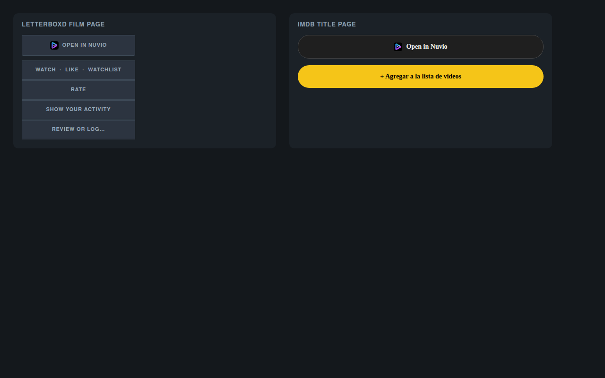

# Open in Nuvio

A small browser extension that adds an **Open in Nuvio** button to Letterboxd film pages and
IMDb title pages, so the title you're looking at opens in the [Nuvio](https://github.com/NuvioMedia)
app with one click.



Nuvio already accepts deep links like `nuvio://meta?type=movie&id=tt0133093`, but nothing on a
movie page can trigger one. This extension adds the button, in the same place the classic
"open in Stremio" extensions put theirs.

## What it does

| Site | Where the button goes |
|---|---|
| **Letterboxd** (`/film/*`) | Top of the right-hand column, above Watch / Like / Watchlist. It samples the panel's own colours so it matches your theme. |
| **IMDb** (`/title/*`) | Directly above the "Add to Watchlist" pill, matching that button's height and rounding. |

The button reads the IMDb id already present on the page (URL, canonical link, or the page's
own IMDb link), works out whether the title is a film or a series, and links to:

```
nuvio://meta?type=movie&id=tt0133093
nuvio://meta?type=series&id=tt0944947
```

## Does Nuvio handle the `nuvio://` scheme?

- **macOS desktop app** — yes. `Info.plist` declares `nuvio` and `stremio` in
  `CFBundleURLSchemes`, and `Main.kt` installs a `Desktop.setOpenURIHandler`.
- **Android / Android TV / Fire TV** — yes (intent filter on `nuvio://`).
- **iOS** — yes (`CFBundleURLSchemes` in `iosApp/Info.plist`).
- **webOS (LG)** — not yet, tracked upstream in NuvioTVSmart #1144.
- **Plain browser** — no handler, so nothing happens without the app installed.

Quick check on macOS before installing:

```bash
open "nuvio://meta?type=movie&id=tt0133093"
```

If it does nothing, refresh LaunchServices:

```bash
/System/Library/Frameworks/CoreServices.framework/Frameworks/CoreServices.framework/Support/lsregister -f /Applications/Nuvio.app
```

## Install (unpacked, for now)

1. Clone this repo.
2. Open `chrome://extensions` and enable **Developer mode**.
3. **Load unpacked** → pick the repo folder.
4. Visit a Letterboxd or IMDb title page.

The first click triggers Chrome's "Open Nuvio?" prompt — tick **Always allow**.

Firefox: `about:debugging` → This Firefox → Load Temporary Add-on → `manifest.json`.

## How it's built

- Manifest V3 content script, no background worker, **no permissions at all** — no `storage`,
  no `host_permissions`, no analytics. It only runs on the two hosts it declares.
- `content.js` — id/type detection, deep-link construction, placement, theme matching.
- `nuvio.css` — button styling for both sites, light and dark.

Both sites are moving targets, so placement is deliberately defensive:

- IMDb: walk up from the watchlist button until a container is a real stack but under 5x the
  button's height, then insert directly above the watchlist row. Falls back to the hero title
  block, then to a fixed bottom-right pill.
- Letterboxd: first child of `.sidebar`, re-inserted if the host re-renders that column, with
  colours copied from the site's own panel. The theme flag is `data-nuvio-theme`, **not**
  `data-theme` — Letterboxd paints every `[data-theme]` element with its own background.

If the button goes missing after a site redesign, `docs/debug-imdb.js` prints and copies a
diagnostic JSON: whether the CSS loaded, whether an id was found, where the button ended up,
and which anchors exist.

## Status

Working on Chrome, Edge, Brave, Arc and Vivaldi. Not on the Chrome Web Store yet — for now it's
an unpacked extension.

## Disclaimer

Unofficial companion. Not affiliated with Nuvio, Letterboxd or IMDb. The Nuvio name and mark
belong to their respective owners; Letterboxd and IMDb are trademarks of their respective
owners.
